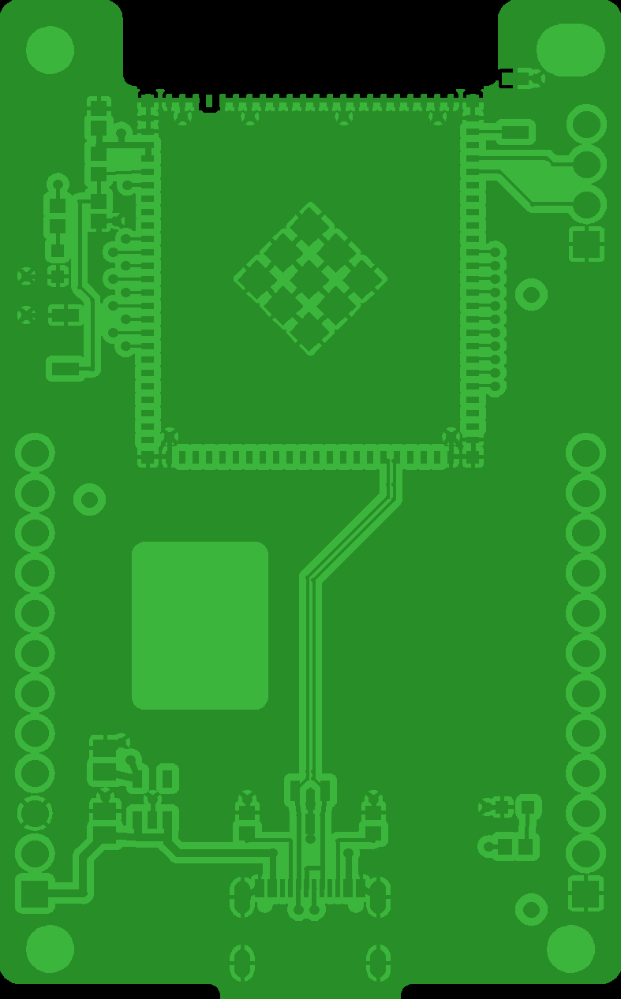
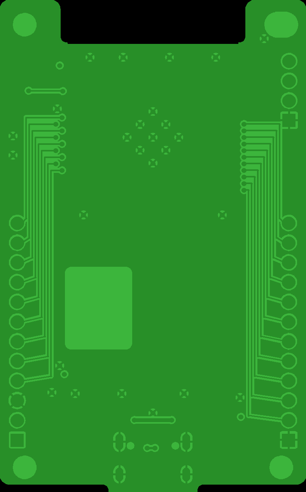

# ESP32-S31 dev board (end-to-end acceptance board)

Release plan step 5: a real ESP32-S31-WROOM-3 development board designed from components to Gerbers through Sparksmith's own command engine, as a CLI/MCP client would. The run, its friction and its gaps are in [docs/e2e-esp32-devboard.md](../../docs/e2e-esp32-devboard.md).

**Status: an unreviewed design.** ERC is clear. The production check reports ten warnings and zero errors or waivers under PCBWay 4-layer. One is that the 90 Ω check excludes 7.934 mm on each USB signal path; nine are the ground vias in the module's exposed pad, whose holes are open under solder paste. An independent Gerber parser cross-checked the fabrication outputs. No person has reviewed it, and no board has been built. Several limits are listed below. Do not order it unreviewed.

## Files

| File | What |
|---|---|
| `esp32-s31-devboard.sparksmith` | The project. Open it in the desktop app. It holds the parts library, two schematic sheets, the 4-layer board, the fills and the waiver-free production state. |
| `esp32-s31-devboard.replay.jsonl` | The full command sequence: 648 JSON-lines requests through `sparksmith stdio --operator`. It replays to the committed project, byte for byte (`cargo test -p sparksmith-automation --features test-fixtures --test example_replay` checks it). |
| `regenerate.sh` | Replays the board and writes `fab/` and the schematic PDF. With `NATIVE=1` it also writes the `.solidcraft` model (about 10 s of CPU). |
| `fab/` | Gerber X2 for 4 copper layers, masks, top paste, top legend and profile; plated and non-plated Excellon; drill map and table; job file; top pick-and-place; both BOMs; fabrication and assembly PDFs. |
| `esp32-s31-devboard-schematic.pdf` | The schematic, two sheets. |
| `authoring/` | The Python client that wrote the replay: placement coordinates, routes and part data with their datasheet sources. It is not application code. `python3 -B examples/esp32-s31-devboard/authoring/build.py lib` from the repository root records the parts stage: the shipped generators make the chip passives, LED, headers and SOT-23 packages (`library.generate_part`), `library.draft_closure` makes each the board's own, and the datasheet pinouts go onto those drafts. The later stages' scripts predate the stored-nanometre and fab-profile changes; their requests in the replay were last carried onto the new parts stage with every library, instance and terminal id mapped. `python3 -B examples/esp32-s31-devboard/authoring/board_shape.py` records the board stage's outline sketch and every part dimension (its parameter table is the [board's](#parameters)): it replays the replay, replaces those requests and leaves the rest as recorded. Six parts-stage requests edit a generated part by sending its whole body back (two rename a package; four type the chip resistor's and capacitors' components with the board's fields or give the push button its `SW` prefix), so after a generator change `python3 -B examples/esp32-s31-devboard/authoring/rebase.py` carries them onto the current generator, keeping only the authored changes, before `regenerate.sh`. |
| `parts/b3u-1000p.solidcraft` | The switches' 3D model: original work (MIT OR Apache-2.0), authored through Solidcraft's commands by `cargo test -p sparksmith-solidcraft --test author_parts -- --ignored`. `sparksmith part check` checks it. |
| `parts/usb4105.solidcraft` | J1's 3D model, authored the same way: a nickel shell with a stadium (racetrack) cross-section, sketched and extruded, open at the mating face, with its four stakes; the LCP insulator closing its rear and the round-cornered tongue centred in the opening; the twelve gold solder tails of the rear row. The board holds J1 by its shell's front face (`F2:start`, the extrusion's start face): two part dimensions keep that face on the USB tab's edge and J1's origin at `width / 2` from the left edge, so J1 follows a change of the board's width. |
| `images/` | Schematic pages; copper layers rendered by PyGerber (MIT) from the Gerber files; desktop screenshots of PCB 2D and 3D, taken of the board's earlier outline. |

```sh
cargo build --locked --profile ci -p sparksmith-cli        # or inside nix develop
sh examples/esp32-s31-devboard/regenerate.sh
```

After a generator changes, run `sh examples/esp32-s31-devboard/regenerate.sh --rebase` with the rebuilt CLI and bundles. This carries authored edits onto the new generated parts before replaying. The source module has no project ID. On its first save the board receives a deterministic ID from its own contents and filename. An updated generator can therefore change the board ID. Commit the resulting fabrication files with the board so their IDs agree.

## Board

- **Outline:** 40 × 64 mm overall, sketched and fully dimensioned (the sketch solves with no freedom left, and every dimension of it is a [board parameter](#parameters)):
  - a 12 mm tab that stands 1 mm out of the bottom edge and carries the USB-C receptacle, so the receptacle's mouth reaches the outer face of an enclosure wall that seats on the shoulders beside the tab;
  - a notch 23.2 mm wide and 5.5 mm deep in the top edge, under the module's antenna, between two ears;
  - three M2.5 mounting holes (2.7 mm NPTH), each `inset` (3.5 mm) from its two edges, and in the right ear a mounting slot 2.7 mm wide with 1 mm of travel along the width, which takes up the tolerance of an enclosure's boss spacing;
  - a pass-through window, 8 × 10 mm, between the headers and left of the USB pair, for wiring or an enclosure post;
  - 1.5 mm outside corners and 0.5 mm inside corners (the router bit's radius); the tab's own two corners are square.
- **Stackup:** 4 layers, 1.6 mm finished. From the top: signal, prepreg 0.2 mm (2116), GND plane, core 1.06 mm (7628), 3V3 plane, prepreg 0.2 mm, signal. Both inner foils are marked as reference planes. The Dk values are Sparksmith's generic estimates.
- **Rules:** the profile file [`library/profiles/pcbway-4-layer.json`](../../library/profiles/pcbway-4-layer.json), written from PCBWay's [manufacturing tolerances](https://www.pcbway.com/pcb_prototype/PCB_Manufacturing_tolerances.html) and [capabilities](https://www.pcbway.com/capabilities.html) pages (read 2026-11-16; every rule cites its row), with *PCBWay values* set to *Minimum* (`rules.set_fab_options`, `limits: minimum`). The board uses PCBWay because its published minimum, 0.15 mm from an unplated hole to copper, admits J1's land pattern as GCT draws it; JLCPCB's 0.2 mm does not, with no option that relaxes it. Overrides: copper (track, pad, via, fill) to board edge 0.3 mm, which is PCBWay's own value, so the override only pins it, and legend to edge 0.2 mm (PCBWay publishes no legend-to-edge limit).
- **Net classes:**
  - Power (GND, +3V3, VBUS): 0.5 mm tracks, 0.3 mm minimum.
  - USB: 90 Ω differential. On top this derives a 0.246 mm width and a 0.127 mm gap (PCBWay's minimum spacing), as microstrip over the GND plane.
- **Fills:** each follows the board outline (`region: board`), so changing a board parameter on the Board card moves the pours with the outline, the window, the slot and the holes; a refill fills the new shape.
  - GND on Inner 1 and on Bottom.
  - +3V3 on Inner 2.
  - GND on Top, with a 0.4 mm fill clearance so the USB pair stays a microstrip.
  - The module's antenna keep-out (from its footprint) moves with the module. It lies over the antenna notch; the 0.5 mm of it on the board below the notch keeps copper off all four layers there.

### Parameters

The board parameters (Board card, or `board.edit` with `set_parameter`). A value in *italics* is an expression over the others.

| Parameter | Value | Drives |
|---|---|---|
| `width`, `height` | 40 mm, 64 mm | The overall size: left to right edge, and the tab's edge to the ears' tops |
| `corner_r`, `inner_r` | 1.5 mm, 0.5 mm | Every outside corner; every inside corner (tab, notch, window) |
| `usb_tab_w`, `usb_tab_d` | 12 mm, 1 mm | The USB tab's width and how far it stands out |
| `tab_x` | *(width − usb_tab_w) / 2* | Each side of the tab from the nearer side edge: the tab stays centred |
| `ant_w`, `ant_d` | 23.2 mm, 5.5 mm | The antenna notch's width and depth |
| `ear_w` | *(width − ant_w) / 2* | Each ear's width: the notch stays centred |
| `inset` | 3.5 mm | Each mounting hole, and the slot's centre, from their two edges |
| `hole_d` | 2.7 mm | The mounting holes' drill and the slot's width |
| `slot_play` | 1 mm | The slot's travel, between its cap centres |
| `slot_edge` | *inset − slot_play / 2* | The slot's outer cap centre from the right edge |
| `win_w`, `win_h` | 8 mm, 10 mm | The window's size |
| `win_off` | 7 mm | The window's centre, left of the board's centre line |
| `win_x` | *width / 2 − win_off − win_w / 2* | The window's left side from the left edge |
| `win_y` | 19 mm | The window's lower side from the tab's edge |
| `header_span` | 34.92 mm | The spacing of the two header rows (part dimensions only) |
| `header_y` | 21 mm | The headers' centres above the tab's edge (part dimensions only) |
| `fid_off` | 14 mm | The fiducials, either side of the centre line (part dimensions only) |

Every placed part is held by part dimensions, so nothing on the board is where it is by its coordinates. Along x every part is measured from the left edge, which stands on the sketch's origin: a distance does not say which side of its edge the part is on, and the right edge would pass the parts near it when the board is made much narrower in one step.

| Parts | Held by |
|---|---|
| J1 (USB-C) | Its shell's front face on the tab's edge (0 mm); its origin `width / 2` from the left edge |
| U1 (module) | Its antenna end (the module board's `F1:+y` face) on the top edge (0 mm); its origin `width / 2` from the left edge |
| U3, R4, R5, U2, C1, C2, R2, D1 | Their offsets along x and y from J1, which they serve (ESD, CC pull-downs, regulator and its capacitors, power LED) |
| C3, R1, C4, R3, D2, SW1, SW2, J4 | Their offsets along x and y from U1 (decoupling, EN delay, user LED, RESET, BOOT, UART header) |
| J2, J3 (headers) | `(width − header_span) / 2` and `(width + header_span) / 2` from the left edge; `header_y` from the tab's edge |
| FID1, FID2, FID3 | `width / 2 + fid_off`, `width / 2 − fid_off` and `width / 2 + fid_off` from the left edge; 6 mm and 32 mm from the tab's edge, 19 mm from the top edge |

What follows a parameter change (`cargo test -p sparksmith-automation --test esp32_parametric`):

- The outline, the holes, the slot and the window re-solve. The pours take the new outline at once and are stale until they are refilled.
- The parts move by their dimensions and carry the copper on their pads. A change of `width` moves every part with the centre line; a change of `height` moves the module and the parts beside it with the top edge, and the header buses and the USB pair stretch between.
- The 3D view and `sparksmith export` build the new board; `interface.list` and `interface.publish` give a linked design the new outline, cutouts, hole axes and receptacle opening.
- A change the design cannot take is refused with the reason and changes nothing: header rows closer than their buses allow (`header_span` 32.92 mm: "Cannot keep connected copper on IO5, …"), an inside radius larger than the tab stands out, a notch wider than the board. A change the outline takes but the layout does not is an error of the production check: `ant_w` 24 mm leaves SW2's pad 0.15 mm from the notch.

## Circuit and parts

| Ref | Part | Manufacturer | Why |
|---|---|---|---|
| U1 | ESP32-S31-WROOM-3 | Espressif | The module (`examples/esp32-s31-wroom-3`, published here) |
| U2 | TLV75733PDBVR | Texas Instruments | 3.3 V LDO for 1 A. The module needs at least 0.6 A from its supply (datasheet v0.7, Table 6-2). The dropout at 1 A is about 0.4 V, which fits 5 V to 3.3 V. |
| U3 | TPD2E009DBZR | Texas Instruments | 2-channel ESD protection on D+ and D−, 0.9 pF |
| J1 | USB4105-GF-A | GCT | USB-C receptacle for USB 2.0, with both plug orientations joined |
| R4, R5 | RC0603FR-075K1L (5.1 kΩ) | Yageo | CC1/CC2 pull-downs (sink role) |
| C1 | GRM21BR61C106KE15L (10 µF 16 V) | Murata | LDO input |
| C2 | GRM21BR61A226ME51L (22 µF 10 V) | Murata | 3V3 bulk, per the module's peripheral schematic (22 µF + 0.1 µF) |
| C3 | GRM188R71C104KA01D (100 nF 16 V) | Murata | Decoupling at module pins 3 and 4 |
| R1, C4 | RC0603FR-0710KL (10 kΩ), GRM188R61C105KA93D (1 µF) | Yageo, Murata | EN RC delay. The module datasheet recommends R = 10 kΩ and C = 1 µF. |
| SW1, SW2 | B3U-1000P | Omron | RESET (EN to GND) and BOOT (IO61 to GND). IO61 low with IO60 high (internal pull-up) selects joint download boot, Table 4-3. |
| D1, D2 | APT1608SGC | Kingbright | Power LED on 3V3 and user LED on IO2, each through 470 Ω (RC0603FR-07470RL) |
| J2, J3 | TSW-112-07-G-S | Samtec | GPIO breakout. J2: VBUS, 3V3, GND, IO12…IO4. J3: GND, IO42…IO52. |
| J4 | TSW-104-07-G-S | Samtec | UART0: GND, TX0, RX0, 3V3 |

The BOM (`fab/esp32-s31-devboard-bom.csv`) has 15 lines and 20 parts, every line resolved to a manufacturer Part.

The USB-C port goes to the module's **USB Serial/JTAG** pins: IO34 (D+, pin 43) and IO33 (D−, pin 42). The ROM uses this path for download and console. The High-Speed OTG pins (40 and 41) are left unconnected. The 30 unused module IOs and the receptacle's SBU pins are marked no-connect.

### Sources

The values come from manufacturers' public datasheets, used as datasheets. None of these files is redistributed here:

- Espressif:
  - ESP32-S31-WROOM-3 datasheet v0.7: pins, supply, EN RC, strapping, peripheral schematic.
  - ESP32-S31 chip datasheet v0.5: USB Serial/JTAG on GPIO33/34.
- TI:
  - TLV757P (SBVS320/322): pinout, DBV0005A land pattern 0.6 × 1.1 mm.
  - TPD2E009: pinout, DBZ0003A land pattern 0.6 × 1.3 mm.
- GCT: USB4105 drawing (rev B4, <https://gct.co/files/drawings/usb4105.pdf>), Recommended PCB Layout, and these values for the receptacle's part file: the outline (8.94 × 7.35 × 3.31 mm) and the 8.34 × 2.56 mm opening 1.73 mm up, from which the 0.30 mm shell and its stadium section follow; the stakes 2.60 mm and 2.60 + 4.18 mm from the mating face, the front ones 1.10 mm long; the tails' x positions (0.5 mm pitch, VBUS at ±2.40 mm, GND at ±3.20 mm) and widths (0.20 mm signal, 0.45 mm shared). Illustrative: the cavity depth, the tongue (6.7 × 0.7 mm, 0.6 mm behind the face, 0.3 mm corners), the rear stakes' length (the front ones'), and the tails' thickness, reach and run under the shell. The stakes are drawn above the seating plane only. GCT's STEP model for the USB4105-GF-A was not used: gct.co serves its model downloads behind a browser check that refused a scripted download, so the shape follows the drawing alone.
- Omron: B3U catalog, PCB pad and the B3U-1000P(M) dimensions (p.2) for the switch's part file: housing 3 × 2.5 mm, 1.2 mm to the cover, 1.6 mm over the 1.5 mm plunger, 4 mm over the 1.4 mm wide terminals. The drawing gives no cover or terminal thickness; the part file's 0.1 and 0.15 mm are illustrative.
- Kingbright: APT1608SGC, recommended soldering pattern; pad 1 is the cathode.
- Murata and Yageo: MPNs and ratings from the product series pages. The capacitor and resistor lands are the chip generator's estimates.
- Samtec: TSW. The header footprint is the header generator's 2.54 mm header.

No EDA tool's library or code was used, and no vendor CAD file was used. The module's own Espressif CAD cross-check is described in its example.

## Images

Schematic (sheet 1: power and USB; sheet 2: module and IO):


Copper, rendered from the Gerber files by PyGerber 2.4.3 (MIT), an independent parser. In order: top, Inner 1 (GND), Inner 2 (3V3), bottom.






The board in the desktop app, PCB 2D and the integrated 3D view. Both screenshots show the board's earlier outline, a 40 × 64 mm rounded rectangle with four mounting holes, before its fiducials, legend moves and the switch to PCBWay's clearances; they are to be retaken:


## Design notes and known limits

- **USB pair.** The pair targets 90 Ω on the top layer. Between the receptacle and the ESD diodes its straight tracks run 1.5 mm apart centre to centre. The route from the ESD diodes to the module includes coupled stretches and fan-outs.
  - The plug orientations are joined at the receptacle: A6 to B6 by a short top track, and A7 to B7 by two vias and a bottom track under the receptacle. The vias are tented, under the connector body.
  - USB_DP runs from J1.B6 to U1.43 and USB_DN from J1.B7 to U1.42. Each path measures 29.886 mm, of which 21.951 mm overlaps the other path at the target gap. Both have 7.934 mm outside the coupled-line impedance calculation, within the class’s 12 mm uncoupled-length limit. The connector joins to J1.A6 (2.245 mm) and J1.A7 (6.98 mm) are additional copper outside those paths.
- **GPIO buses.** They run on the bottom layer, so no part sits in their way. The header order follows the module's pin order (J2 pin 4 = IO12 … pin 12 = IO4), so the buses route without crossings.
- **USB-C land pattern.** J1's footprint is GCT's recommended layout (drawing rev B4) as drawn: its two Ø0.65 mm locating holes sit 0.175 mm from the GND lands beside them, and its shell slots keep 0.2 mm rings. Both meet PCBWay 4-layer at its minimum values, so the board needs no waiver (`crates/io/tests/usb_c_part.rs`).
- **EPAD.** Each of its nine squares has a via to the GND plane. The datasheet makes soldering the EPAD optional and recommends a moderate amount of paste. The paste follows the footprint's default.
- **3D models.** The module uses its parametric part file. The passives, the LEDs (the chip-LED row, from the Kingbright drawing), the SOT parts and the headers use generated models. The USB-C receptacle uses the example's `parts/usb4105.solidcraft`, and the two switches use the example's own part file, `parts/b3u-1000p.solidcraft`: a parametric Solidcraft design (housing, metal cover, plunger and terminals) whose defaults are the B3U-1000P drawing's dimensions.
- **Legend.** U1's footprint outline runs over the antenna notch and passes the top edge by 0.225 mm at the antenna end; the fabricator trims those lines (the production check covers legend text, not lines). J2's and U1's designators are moved onto the board with `instance.set_text_placement`. The switch footprint prints its designator outside the body outline, on the side away from SW2's neighbour U1, whose pads its old spot touched.
- **Antenna.** The module's antenna end is on the top edge and its antenna hangs over the notch, so no laminate and no copper lie under it. The ears beside the notch carry the pours, a mounting hole and the mounting slot within 2 mm of the module's sides. Espressif's guidelines ask for about 15 mm of clearance around the antenna on the host side; the board does not give that beside the module.
- **Parameter changes.** A board edit moves parts only where their copper can follow: a route between parts that slide two different ways in one edit is carried, a route between parts that slide three ways is re-routed or the edit is refused. The header rows cannot come closer than their buses are routed (`header_span`), and the notch, the tab, the slot and the window have the room the layout leaves them: SW2 stands 0.55 mm from the notch.
